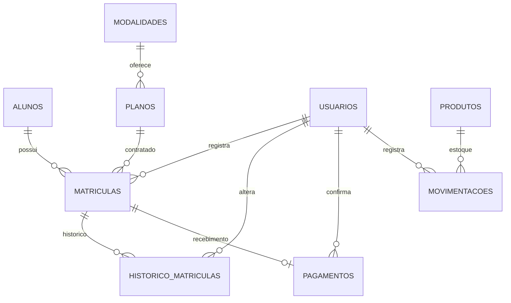
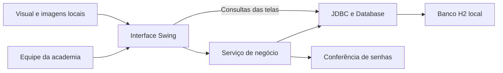

# Análise completa do Pulso — Academia Movimento

**Data da revisão:** 9 de outubro de 2026.  
**Versão analisada:** projeto existente na pasta Academia, com a interface Grafite.  
**Finalidade:** explicar o sistema inteiro, suas telas, regras, estrutura, qualidade e limites reais.

## 1. O que é o sistema

O **Pulso** é um aplicativo desktop de gestão administrativa de academia. Foi desenvolvido em Java para o cenário acadêmico do Grupo 05, usando a Academia Movimento como cliente fictício.

O aplicativo organiza o atendimento e os registros administrativos: alunos, atividades oferecidas, planos, contratações, pagamentos, produtos, movimentações de estoque e contas da equipe. Os dados ficam em um banco relacional local e continuam disponíveis depois de fechar e abrir o programa.

O público que utiliza a ferramenta é a equipe da academia, por meio de dois perfis: administrador e atendente. O aluno aparece como pessoa cadastrada e titular de contratos; ele não tem uma conta de acesso ao sistema nesta versão.

O propósito central é permitir que a recepção execute uma sequência completa de atendimento e que a administração acompanhe contratos e estoque. A identidade visual inclui uma marca própria, fotografias fictícias, tema escuro, ícones desenhados e animações.

**Classificação da versão atual:** aplicação acadêmica funcional, com dados persistentes e regras de negócio implementadas. A estrutura permite demonstrar processos reais de atendimento; ainda existem falhas e recursos ausentes que precisam ser tratados antes de uma operação comercial mais exigente.

## 2. Como esta análise foi realizada

A revisão considerou as seis classes principais da aplicação, o esquema SQL, os testes, as configurações de execução, os scripts e a documentação existente. O código principal foi recompilado nesta revisão com compatibilidade Java 17, sem erros.

Também foram executadas três verificações direcionadas em um banco H2 exclusivamente em memória. Elas reproduziram os problemas de revogação de permissões, atualização parcial de usuário e ordenação textual de códigos descritos na seção 12. A janela utilizada para examinar a tabela permaneceu invisível. O banco de dados da academia não foi acessado por essas provas.

O relatório existente de testes registra **51 verificações aprovadas em 09/10/2026, às 10h44, no horário de São Paulo**. Esse resultado é a última execução registrada da suíte; os 51 casos não foram executados novamente nesta análise. A compilação e as três provas adicionais foram realizadas agora.

A documentação também registra verificações visuais anteriores. A revisão atual não inclui uma nova navegação manual de todas as telas no IntelliJ nem um ensaio completo de apresentação. Uma inspeção de código permite identificar comportamento e riscos, mas não estabelece um percentual de cobertura de testes nem garante ausência de falhas.

**Nenhum arquivo de implementação da aplicação foi alterado nesta análise.** Foram acrescentados este relatório e um programa auxiliar de verificação na pasta de preparação `.build`.

## 3. Exemplo de funcionamento do começo ao fim

Uma pessoa chega à recepção e deseja contratar um plano. O atendente entra com sua conta, cadastra o aluno, consulta os planos disponíveis e cria uma matrícula. O sistema calcula a data final com base na duração do plano e guarda o valor contratado.

Considere o plano de demonstração **Trimestral funcional**, com duração de três meses e valor total de **R$ 329,90**. Uma contratação iniciada em **09/10/2026** termina em **09/01/2027**. O pagamento registrado para essa matrícula é de R$ 329,90, uma única vez.

Depois de o responsável confirmar que recebeu o valor, ele registra no aplicativo a forma de pagamento: PIX, dinheiro ou cartão. A matrícula passa a aparecer como paga. Esse registro não efetua uma transação bancária: ele informa ao sistema que o recebimento já aconteceu fora dele.

Se o aluno solicitar uma pausa, a equipe pode trancar a matrícula e registrar o motivo. A alteração aparece no histórico com data e responsável. Se o aluno voltar, o contrato pode retornar a ativo. A data final permanece a mesma, pois a regra atual não prorroga a validade durante o trancamento.

Na rotina de estoque, a equipe registra a entrada de produtos recebidos e a saída de itens entregues ou utilizados. Cada movimento guarda quantidade, motivo e responsável. Quando o saldo fica menor ou igual ao mínimo, o produto aparece como item para reposição.

## 4. Pessoas, contas e permissões

Há três conceitos diferentes:

- **Aluno:** pessoa atendida pela academia, cadastrada com identificação e contato.
- **Usuário:** integrante da equipe que possui login e senha para operar o aplicativo.
- **Perfil:** conjunto de permissões associado ao usuário, ADMIN ou ATENDENTE.

Um aluno não recebe automaticamente uma conta de usuário. Da mesma forma, cadastrar um usuário não cria uma matrícula ou um aluno.

| Operação | Administrador | Atendente |
| --- | --- | --- |
| Consultar a visão geral | Sim | Sim |
| Consultar, pesquisar, cadastrar e editar alunos | Sim | Sim |
| Consultar a ficha de um aluno | Sim | Sim |
| Consultar modalidades, planos e produtos | Sim | Sim |
| Criar e editar modalidades | Sim | Não |
| Criar e editar planos | Sim | Não |
| Criar e editar produtos | Sim | Não |
| Registrar matrícula | Sim | Sim |
| Trancar, retomar ou cancelar matrícula | Sim | Sim |
| Consultar histórico e registrar pagamento | Sim | Sim |
| Registrar entradas e saídas de estoque | Sim | Sim |
| Criar e editar contas de usuários | Sim | Não |

Os botões de edição administrativa são ocultados para atendentes. Além disso, os métodos que modificam modalidades, planos, produtos e usuários verificam o perfil no serviço de negócio. Essa segunda verificação evita depender apenas da aparência da tela.

Existe uma proteção para impedir que um administrador desative a própria conta ou retire seu próprio perfil administrativo. Entretanto, as permissões de uma sessão já aberta ficam guardadas em memória e não são consultadas novamente a cada operação. Esse problema está detalhado na seção 12.

As contas iniciais de demonstração são `admin`, com senha `Admin@123`, e `recepcao`, com senha `Recepcao@123`. Elas são exemplos para a apresentação, documentados no projeto.

## 5. Todas as telas e suas funções

O administrador possui **oito áreas no menu principal**. O atendente possui sete, pois a área Usuários fica indisponível. A abertura animada e o login são etapas anteriores ao menu.

### 5.1. Abertura animada

A abertura apresenta a marca Pulso sobre um fundo escuro com iluminação em cobre, círculos e desenho progressivo do símbolo. Sua duração nominal é de aproximadamente 2,2 segundos. O usuário pode clicar em **Pular abertura**.

Trata-se de uma animação produzida pelo próprio código Java. Não existe um arquivo de vídeo sendo reproduzido nessa etapa. A barra visual acompanha o tempo da animação; ela não mede carregamento do banco, que já é inicializado antes da janela.

### 5.2. Login

Contém os campos usuário e senha e o botão **Acessar minha academia**. Também apresenta a identidade visual e uma fotografia fictícia de academia.

O sistema pesquisa uma conta ativa, compara a senha informada com o hash armazenado e inicia a sessão quando a conferência é válida. A mensagem de falha não informa separadamente se o usuário existe ou se a senha está errada.

Após entrar, o menu é montado de acordo com o perfil. Ao encerrar a sessão, a referência do usuário autenticado é removida e a tela de login reaparece.

Nesta versão não há recuperação de senha por e-mail, autenticação em duas etapas ou bloqueio temporário por tentativas incorretas.

### 5.3. Visão geral

A visão geral reúne informações consultadas diretamente do banco:

| Indicador | O que é contado |
| --- | --- |
| Alunos ativos | Cadastros de alunos com o campo ativo verdadeiro |
| Matrículas ativas | Contratos cuja situação registrada é ATIVA |
| Pagamentos pendentes | Matrículas não canceladas sem registro de pagamento |
| Itens para repor | Produtos com saldo menor ou igual ao estoque mínimo |

Também aparecem as cinco últimas matrículas inseridas, um gráfico circular com contratos ativos, trancados e cancelados e atalhos para cadastrar matrícula e consultar estoque.

Os números são reais em relação ao banco utilizado pelo aplicativo. As imagens e os exemplos iniciais são fictícios, mas os indicadores não são valores fixos desenhados na tela.

Há duas interpretações importantes: o número de matrículas ativas considera a situação, sem verificar se a validade terminou; e pagamento pendente significa contratação sem recebimento registrado, sem cálculo de atraso ou parcelas mensais.

Os dados são atualizados ao abrir a área e após operações que recarregam a tela. Não há atualização contínua em segundo plano. O selo **EQUIPE CONECTADA** faz parte da interface e não representa uma contagem de usuários online ou conexão com servidor externo.

### 5.4. Alunos

Apresenta código, nome, CPF, telefone, e-mail e indicação de cadastro ativo. A área inclui pesquisa na tabela, adicionar aluno, editar e abrir a ficha. Cartões no topo mostram até duas pessoas do cadastro e a quantidade total de registros.

O formulário permite informar nome, CPF, telefone com DDD, e-mail, situação do cadastro e um retrato da galeria fictícia. As regras são:

- Nome obrigatório, com até 100 caracteres.
- CPF único, com 11 dígitos e conferência dos dois dígitos verificadores.
- Remoção de pontos, hífen e espaços do CPF antes de armazenar.
- Rejeição de CPF formado por dígitos todos iguais.
- Telefone obrigatório, com até 20 caracteres e pelo menos dez dígitos numéricos.
- E-mail obrigatório, com até 120 caracteres e conferência básica de formato.
- Impedimento de inativar um aluno com matrícula aberta, ativa ou trancada.

A validação do CPF verifica sua estrutura matemática. Não consulta a identidade ou a situação cadastral da pessoa em um serviço externo. A validação de telefone e e-mail também não confirma que o contato pertence ao aluno ou funciona.

A **ficha do aluno** reúne foto, identificação, contatos e todos os contratos daquele cadastro, com plano, início, fim, situação e valor. É uma ficha administrativa. A versão atual não registra avaliação física, lesões, medidas corporais ou séries de exercícios.

Os retratos disponíveis são quatro imagens já incluídas no projeto. O aplicativo não gera uma pessoa nova para cada aluno nem oferece envio de foto própria.

### 5.5. Modalidades

Representa as atividades oferecidas pela academia. Os exemplos iniciais são musculação, funcional e pilates.

Cada modalidade tem código, nome e descrição. O nome deve ser único, com até 80 caracteres, e a descrição é obrigatória, com até 250 caracteres. A administração cria e edita; a recepção consulta.

A galeria exibe até três modalidades, escolhidas pela ordem de cadastro, com fotografia e quantidade de planos relacionados. Todas as modalidades continuam disponíveis na tabela, inclusive as que não aparecem nos três cartões.

A fotografia é escolhida pelo código a partir do nome da modalidade. Nomes relacionados a musculação, funcional e pilates usam imagens específicas; outros usam a imagem geral da academia. Não existe upload de uma imagem exclusiva por modalidade.

A modalidade é uma categoria de atividade. Não representa uma turma com horário, instrutor, capacidade ou agendamento.

### 5.6. Planos

Define os produtos contratuais oferecidos aos alunos. A tabela apresenta código, nome do plano, modalidade, valor total e duração em meses.

O administrador informa nome, modalidade existente, valor e meses. O nome é obrigatório e único. O valor deve ser maior que zero, possuir no máximo duas casas decimais e caber no limite do campo monetário. A duração permitida vai de um a 36 meses.

O valor cadastrado corresponde ao período completo. Por exemplo, um plano de três meses por R$ 329,90 representa uma contratação total nesse valor. Não gera automaticamente três cobranças mensais.

Quando uma matrícula é criada, o valor é copiado para o contrato e a data final é calculada. Alterações posteriores no valor ou duração do plano não recalculam esses contratos antigos. O nome do plano e da modalidade, porém, continua sendo consultado no cadastro atual e pode mudar na exibição histórica.

Não há descontos, combinações de modalidades em um único plano, frequência semanal contratada ou renovação automática.

### 5.7. Matrículas

É a área que relaciona alunos a planos. A tabela mostra código, aluno, plano, início, fim, situação, pagamento e valor contratado.

As ações disponíveis são **Nova matrícula**, **Situação**, **Pagamento** e **Histórico**. O formulário de matrícula permite selecionar um aluno ativo, um plano existente e uma data inicial válida no formato dia/mês/ano.

Ao salvar, o sistema calcula o fim usando a quantidade de meses do plano, cria o contrato como ATIVA, copia o preço vigente e registra um primeiro evento de histórico com o responsável.

O aluno pode possuir contratos em planos diferentes. Para o mesmo plano, existe uma regra de duplicidade: enquanto houver uma matrícula ativa ou trancada, outra contratação desse mesmo plano é impedida. O código considera a situação registrada; uma matrícula cuja data final já passou continua aberta para essa regra se não tiver sido cancelada.

| Situação | Significado e alterações permitidas |
| --- | --- |
| ATIVA | Contrato em atividade; pode ser trancado ou cancelado |
| TRANCADA | Contrato pausado; pode voltar a ativo ou ser cancelado |
| CANCELADA | Encerramento definitivo desse registro; permite uma nova contratação |

Toda alteração exige um motivo. O sistema impede salvar a mesma situação novamente e impede reativar uma matrícula cancelada. O histórico guarda situação, motivo, data e usuário responsável.

O trancamento não estende a validade. O vencimento não cancela ou suspende o contrato automaticamente. A data inicial precisa ser válida, mas o serviço não obriga que ela seja a data atual ou uma data futura.

**Pagamento:** registra PIX, DINHEIRO ou CARTAO, no valor total já guardado na matrícula. Há no máximo um pagamento por contrato. Matrículas canceladas não recebem novos pagamentos; matrículas trancadas podem receber. A situação financeira e a situação contratual são independentes, portanto uma matrícula ativa pode estar pendente.

Não existe integração com banco, emissão de QR Code PIX, processamento de cartão, parcelamento, cobrança automática, estorno ou emissão fiscal. Cancelar uma matrícula paga preserva o pagamento; não executa devolução de dinheiro.

O banco guarda data, forma e responsável pelo recebimento. A interface atual resume a informação na lista como pago ou pendente, sem uma área financeira dedicada para relatórios detalhados de recebimentos.

### 5.8. Produtos

Controla o cadastro e o saldo de itens da academia. A tabela apresenta código, nome, unidade, preço, saldo, mínimo e situação do estoque.

O administrador cadastra e edita nome, unidade, preço e estoque mínimo. O nome é obrigatório e único. A unidade é um texto obrigatório, o preço pode ser zero e o mínimo deve ser um número inteiro não negativo.

Um produto cadastrado pelo formulário começa com saldo zero. A quantidade disponível muda por meio de movimentações, evitando uma edição direta do saldo sem justificativa. Os produtos iniciais de demonstração recebem seus saldos na preparação dos exemplos, juntamente com movimentos de entrada.

A regra do alerta é `saldo <= mínimo`. Se o mínimo for dez e o saldo também for dez, o item já aparece como **REPOR**. Um mínimo igual a zero também gera alerta quando o saldo está zerado.

O preço é informativo neste módulo. Registrar a saída de um produto não cria uma venda nem um recebimento. A versão atual não possui fornecedores, pedidos de compra, lotes ou validade de produtos.

### 5.9. Movimentações

Mostra o histórico de entradas e saídas de estoque, com código, data, produto, tipo, quantidade, motivo e responsável.

Administrador e atendente podem registrar movimentos. A quantidade deve ser um inteiro maior que zero, o produto precisa existir e o motivo é obrigatório, com até 250 caracteres.

Uma entrada soma a quantidade ao saldo. Uma saída desconta somente quando existe saldo suficiente. O código atualiza o saldo e grava o histórico dentro da mesma transação. Se o registro do histórico falhar, a alteração de saldo é desfeita.

A proteção da saída ocorre também na instrução de atualização do banco, que exige `saldo >= quantidade`. Isso evita que dois descontos concorrentes consumam a mesma unidade e deixem o estoque negativo.

Não há edição ou exclusão de movimentos pela interface. Uma correção operacional pode ser registrada como outro movimento, com motivo, preservando o anterior. Esse procedimento não cria um vínculo formal de estorno entre os dois movimentos.

Todas as quantidades são inteiras, mesmo que o nome da unidade seja livre. A versão não controla 0,5 unidade ou 2,75 quilos.

### 5.10. Usuários

Área disponível ao administrador. Apresenta código, nome, login, perfil e estado ativo, com pesquisa, criação e edição. Também permite selecionar um dos retratos fictícios.

O login deve ser único, com três a 60 caracteres, usando letras, números, ponto, sublinhado ou hífen. Nome, perfil e estado ativo são controlados no formulário. A senha de uma nova conta ou uma senha substituta deve ter pelo menos oito caracteres.

Ao editar, deixar o campo de senha vazio preserva a senha anterior. Informar uma nova senha gera um hash novo. A senha original não é mostrada na tabela e não é guardada em texto simples.

Não há um perfil exclusivo de professor, financeiro ou aluno. Também não há uma tela de redefinição de senha para a própria recepção: a gestão de contas fica com o administrador.

### 5.11. Comportamentos compartilhados pelas telas

As tabelas não aceitam edição diretamente nas células. As alterações passam pelos formulários, permitindo aplicar validações. Os botões operam sobre a linha selecionada, e o código converte corretamente a seleção da tabela para o registro original quando há filtro ou ordenação.

A pesquisa verifica o texto exibido em qualquer coluna e ignora diferenças entre maiúsculas e minúsculas. Caracteres digitados são tratados literalmente, evitando que o usuário precise conhecer expressões regulares. A busca não remove acentos: procurar `agua` pode não localizar `Água`.

O filtro altera a tabela. Os cartões de destaque e a quantidade total de registros continuam refletindo a lista carregada completa, e não apenas os resultados filtrados.

Formulários apresentam mensagens de validação e mantêm a operação aberta quando ocorre uma falha. Ao salvar com sucesso, a tela é recarregada e aparece uma confirmação temporária. Não existe uma ação geral de excluir cadastros pela interface; alunos e usuários usam inativação, e matrículas usam cancelamento.

## 6. Regras de negócio que precisam ser compreendidas

| Regra | Consequência prática |
| --- | --- |
| CPF único e com dígitos válidos | Impede duplicidade e erros estruturais de identificação |
| Aluno ativo para matrícula | Um cadastro inativo não recebe contratação nova |
| Uma matrícula aberta por aluno e plano | Não permite repetir o mesmo contrato enquanto o anterior estiver ativo ou trancado |
| Valor contratado preservado | Uma mudança no preço do plano não altera o valor de matrículas existentes |
| Pagamento único por matrícula | Cada contratação tem um recebimento integral registrado |
| Situação e pagamento separados | Um contrato ativo pode estar pendente; pagamento não define a situação |
| Cancelamento definitivo do registro | Para voltar depois de cancelar, cria-se uma matrícula nova |
| Motivo para mudar situação | Permite consultar a justificativa e o responsável |
| Trancamento mantém a data final | A pausa não acrescenta dias ou meses ao contrato |
| Validade sem mudança automática de situação | A equipe precisa acompanhar a data e decidir a alteração |
| Produto novo com saldo zero | A disponibilidade é informada por entrada registrada |
| Saída condicionada ao saldo | Não permite retirar mais itens do que há disponíveis |
| Quantidades inteiras | Não há controle de frações de produto |
| Alerta com saldo igual ao mínimo | A reposição é sinalizada antes de ultrapassar esse limite |
| Administrador preserva o próprio acesso | Não pode se inativar ou se tornar atendente pelo formulário |

A decisão de preservar registros evita perder contratos, recebimentos e justificativas por uma exclusão comum na interface. Entretanto, isso não equivale a uma auditoria completa: alterações de nomes, contatos e outros cadastros não possuem versões históricas próprias.

## 7. Banco de dados: o que é armazenado

O banco utilizado é **H2 2.3.232**, acessado por JDBC. Na execução normal, os dados ficam no arquivo `data/pulso.mv.db`, relativo à pasta do projeto. Existem nove tabelas de negócio.

| Tabela | Campos principais | Papel e relacionamento |
| --- | --- | --- |
| `usuarios` | id, nome, login, senha, perfil, ativo, foto | Contas da equipe; responsáveis por contratos, históricos, pagamentos e movimentos |
| `alunos` | id, nome, cpf, telefone, email, ativo, foto | Pessoas atendidas; cada aluno pode ter várias matrículas |
| `modalidades` | id, nome, descricao | Categorias de atividade; uma modalidade possui vários planos |
| `planos` | id, nome, modalidade_id, valor, meses | Condições comerciais e duração; cada plano pode aparecer em vários contratos |
| `matriculas` | id, aluno_id, plano_id, inicio, fim, valor, situacao, criado_por | Contratação de um plano por um aluno |
| `historico_matriculas` | id, matricula_id, situacao, motivo, usuario_id, data | Eventos de mudança de situação de cada contrato |
| `pagamentos` | id, matricula_id, valor, forma, usuario_id, data | Zero ou um recebimento por contrato |
| `produtos` | id, nome, unidade, preco, saldo, minimo | Cadastro e disponibilidade dos itens |
| `movimentacoes` | id, produto_id, tipo, quantidade, motivo, usuario_id, data | Histórico das mudanças de estoque |

Os identificadores são números gerados pelo banco. As referências entre tabelas são chaves estrangeiras: por exemplo, a matrícula aponta para um aluno, um plano e o usuário que a criou. Isso impede cadastrar um contrato apontando para registros inexistentes.

Os valores monetários usam `DECIMAL(10,2)`, com duas casas decimais. No código de negócio são tratados com `BigDecimal`. A duração, o saldo e as quantidades usam inteiros. Início e fim são datas; os eventos de histórico e pagamento guardam data e hora.

O banco impõe unicidade para login, CPF, nomes de modalidade, plano e produto e para a matrícula relacionada a um pagamento. Também impõe saldo não negativo, quantidades positivas, valores permitidos e situações válidas nas principais tabelas.

Nem todas as regras existem em dois lugares. A validade matemática do CPF e a duplicidade de matrícula aberta são verificadas no serviço. A forma de pagamento permitida também é verificada no serviço, enquanto a coluna SQL aceita texto sem uma restrição equivalente. O histórico de situação segue o mesmo padrão: a operação valida a situação antes de gravar, mas a coluna do histórico não possui sua própria lista SQL de valores aceitos.

Existem índices explícitos para consultar matrículas por aluno e movimentações por produto e data. Os dados de foto são referências curtas, como `retratos/ana`; as imagens ficam em arquivos do projeto, não dentro do banco.

Na inicialização, o aplicativo executa instruções de criação condicionadas à inexistência das tabelas e adiciona as colunas de foto quando necessário. Também há preenchimento de retratos para alguns registros conhecidos de demonstração na migração. Não existe uma ferramenta com número de versão de cada migração de banco.

Os dados de demonstração só são inseridos quando a tabela de usuários está vazia. Uma abertura comum do programa não restaura automaticamente os exemplos nem apaga o que a equipe cadastrou.

O conjunto inicial inclui dois usuários, dois alunos, três modalidades, três planos, uma matrícula, dois produtos e os registros associados. Exemplos: Ana Martins, Bruno Oliveira, água de 500 ml e faixa elástica. Esse conjunto inicial não deve ser confundido com a quantidade atual de registros de um banco já utilizado.

## 8. Estrutura do código e tecnologias

| Componente | Responsabilidade |
| --- | --- |
| `Main.java` | Inicializa o banco, prepara exemplos, configura a aparência e abre a janela |
| `AcademiaFrame.java` | Monta login, menu, páginas, tabelas, formulários e consultas da interface |
| `Visual.java` | Define cores, componentes personalizados, ícones, fotos e animações |
| `AcademiaService.java` | Autentica usuários, valida dados, verifica permissões e executa operações de negócio |
| `Database.java` | Abre conexões JDBC, executa SQL, cria o banco e prepara os exemplos |
| `Security.java` | Gera hashes e confere senhas |
| `SystemTest.java` | Executa verificações automáticas do serviço e da integração com o banco |
| `database/schema.sql` | Define tabelas, relacionamentos, restrições, índices e colunas adicionais |
| `pom.xml` | Declara o projeto Maven, compatibilidade Java 17 e dependência H2 |

O código tem separação entre regras de negócio e apresentação, permitindo testar operações sem clicar na interface. Entretanto, a organização ainda concentra consultas SQL, montagem de componentes, navegação e formatação em `AcademiaFrame`. Portanto, a arquitetura é parcialmente dividida em camadas; não é uma implementação estrita de MVC com controladores e repositórios separados por domínio.

A interface utiliza **Swing e AWT**, com desenho personalizado em **Java2D**. Não é uma página aberta em navegador. Não depende de React, JavaFX, servidor web ou serviço de nuvem.

O projeto é compilado com compatibilidade **Java 17**. A configuração desta máquina usa o **JDK 23** instalado. Compilar com compatibilidade 17 não significa que esta revisão testou todas as combinações de versão de Java e sistema operacional.

Há uma biblioteca H2 já incluída na pasta `lib`, permitindo a execução local sem baixar essa dependência. Maven é uma alternativa de organização e compilação. A configuração do IntelliJ aponta para a classe principal `br.com.pulso.Main` e usa a pasta do projeto como diretório de trabalho.

O programa também aceita os modos `--prepare-db`, para preparar o banco sem abrir a interface, e `--screenshots`, para gerar imagens das telas usando um banco separado em memória. O modo de imagens não usa o banco normal de atendimento.

## 9. Aparência, fotografias e efeitos

A identidade Grafite utiliza fundo escuro, superfícies em cinza, texto claro, destaques em cobre e verde para indicações positivas. A tipografia principal é Segoe UI, com tamanhos e pesos distintos para títulos, informações e detalhes.

Os elementos incluem menu lateral, cartões arredondados, selos de situação, tabelas com seleção destacada, bordas de foco, campos padronizados e formulários com rolagem quando necessário.

Os ícones são desenhos feitos em Java2D: pessoas, modalidades, contratos, produtos, busca, edição, confirmação, sair e a marca de pulso. **Não são emojis.** Isso permite manter espessura, cor e tamanho coerentes.

As imagens disponíveis incluem quatro fotografias de ambientes e atividades — abertura, musculação, funcional e pilates — e quatro retratos fictícios. As pessoas representadas nessas imagens foram geradas para o projeto. O sistema não está usando fotografias de alunos reais cadastrados.

As fotografias de ambiente são ajustadas preservando proporção e enquadramento, podendo deixar espaço quando o formato disponível é diferente. Os retratos fornecidos são quadrados e aparecem em molduras arredondadas. A escolha de retrato é salva no cadastro. Se não houver uma imagem disponível, o componente de pessoa apresenta um ícone de substituição.

Os arquivos de imagem são carregados do projeto e mantidos em cache na execução. A interface funciona sem acesso à internet e não faz chamadas a um gerador de imagens durante o uso. A IA foi utilizada na produção dos recursos visuais; não é uma função operacional do aplicativo.

| Efeito | Implementação e duração nominal |
| --- | --- |
| Abertura | Desenho animado da marca, círculos e opacidade, aproximadamente 2,2 s |
| Troca de página | Imagem temporária da tela anterior com desaparecimento gradual, aproximadamente 260 ms |
| Passar o mouse em botões | Interpolação de cor, aproximadamente 160 ms |
| Confirmação ao salvar | Mensagem sobreposta que desaparece após aproximadamente 2,85 s |

Esses efeitos usam temporizadores do Swing. Não há reprodução de vídeo, áudio de abertura ou efeitos 3D. A opção `-Dpulso.reduceMotion=true` reduz o movimento da abertura, transições e botões; `-Dpulso.skipIntro=true` abre diretamente o login.

A janela inicia com 1440 × 940 e exige mínimo de 1200 × 800. Essa escolha favorece a apresentação em uma tela grande, mas precisa ser ajustada para monitores com pouca altura disponível ou escalonamento elevado.

## 10. Segurança e integridade dos dados

Há proteções concretas no código:

- Senhas armazenadas como hash PBKDF2 com HMAC-SHA-256, 120 mil iterações, salt aleatório individual de 16 bytes e chave de 256 bits.
- Conferência do resultado com `MessageDigest.isEqual`.
- Consultas com parâmetros em `PreparedStatement`, evitando concatenar os valores comuns dos formulários ao SQL.
- Verificação de autenticação nas operações do serviço e de perfil nas ações administrativas.
- Restrições relacionais para referências válidas, unicidade e valores permitidos.
- Transações para matrícula com seu histórico inicial, mudança de situação com histórico, pagamento e movimentação de estoque.
- Bloqueio de linhas relevantes e atualização condicional de saldo para proteger operações concorrentes testadas.
- Proibição de retirar o próprio acesso administrativo.

Uma transação significa que um conjunto de alterações deve terminar completo ou ser desfeito. Por exemplo: se a matrícula for criada, mas o histórico inicial não puder ser gravado, o contrato também é desfeito. O mesmo princípio é aplicado ao saldo e ao movimento de estoque.

Existem limites importantes. A conta técnica do banco local é `sa`, com senha vazia, e a URL usada não configura criptografia do arquivo. O login da aplicação é uma proteção separada do acesso direto ao banco. A posse dos arquivos e das ferramentas locais pode permitir acesso ao conteúdo fora da interface.

Não há expiração automática de sessão, limitação de tentativas de login, autenticação em duas etapas, recuperação de senha ou registro completo de todas as alterações de cadastro. O perfil guardado em uma sessão aberta também não é revalidado depois de mudanças administrativas.

Os nomes exibidos em históricos de contratos, pagamentos e estoque são obtidos por relacionamento com os cadastros atuais. Os identificadores responsáveis são preservados, mas uma alteração no nome de usuário, produto ou plano pode mudar o texto exibido para um evento antigo.

## 11. Testes existentes e evidências

O arquivo `SystemTest.java` é um programa de testes com verificações próprias. Ele usa bancos isolados, separados dos dados da aplicação, incluindo testes em memória e um banco temporário de persistência.

A última execução registrada possui **51 casos aprovados**. Entre os comportamentos verificados estão:

- Operação sem autenticação e login incorreto bloqueados.
- Tentativa de usar conteúdo SQL como login sem conseguir autenticar.
- Identificação de perfil e restrições do atendente.
- Senhas com hash e conferência correta.
- Validações de cadastro, CPF, duplicidade e campos financeiros.
- Operações de cadastro e edição, nos cenários cobertos pela suíte.
- Regras de matrícula, valor preservado, situações e histórico.
- Registro de pagamento e impedimento de pagamento duplicado.
- Entradas e saídas de estoque, saldo insuficiente e falhas com reversão da operação.
- Disputa concorrente por saldo, com duas saídas tentando consumir a mesma unidade.
- Reabertura de banco persistente, referências de retratos e migração das colunas de foto.

O comando indicado no projeto é o script `scripts/testar.ps1`. Ele compila aplicação e testes e executa explicitamente `SystemTest`.

**Maven não executa automaticamente esses 51 casos apenas com `mvn test` na configuração atual.** A classe não utiliza JUnit e o projeto não configura o teste principal como tarefa do Maven. É necessário usar o script ou executar a classe de testes.

Existe documentação de testes manuais e revisão visual anterior, incluindo resoluções 1440 × 940 e 1200 × 800. Os roteiros manuais descrevem passos esperados; a existência do roteiro não comprova que todos foram executados nesta revisão.

Não há evidência de ensaio com milhares de cadastros, cobertura automatizada de todas as interações da interface, execução em todos os sistemas operacionais, integração bancária ou recuperação completa após um incidente real. Esses aspectos não podem ser considerados aprovados pelos 51 testes de serviço.

## 12. Problemas confirmados nesta análise

### 12.1. Permissões antigas continuam válidas em uma sessão aberta

**Prioridade:** alta para um cenário com sessões simultâneas ou expansão do aplicativo.

O login cria um objeto em memória com o identificador, o nome e o perfil do usuário. As verificações posteriores conferem esse objeto, sem consultar novamente se a conta está ativa e qual é seu perfil atual.

**Prova realizada:** uma conta administradora abriu uma sessão; outra sessão administrativa mudou essa conta para atendente e a inativou. A sessão antiga conseguiu criar um plano, uma operação reservada a administradores.

**Consequência:** a mudança de permissões passa a ser aplicada no próximo login, mas não revoga imediatamente uma sessão existente. O programa é local e não oferece hoje uma arquitetura de atendimento em rede; a prova demonstra o comportamento do serviço com duas sessões no mesmo banco isolado.

**Correção indicada:** validar a situação atual da conta nas operações protegidas ou implementar invalidação explícita das sessões quando houver inativação ou alteração de perfil.

**Referência:** [AcademiaService.java](C:/Users/gustavo_m_deschamps/Desktop/Academia/src/main/java/br/com/pulso/AcademiaService.java:17), especialmente a criação da sessão e as verificações de autenticação e administrador.

### 12.2. Edição de usuário e troca de senha não formam uma única transação

**Prioridade:** média, por integridade da atualização.

Na edição de usuário, o código primeiro atualiza nome, login, perfil, estado e foto. Se houver senha nova, executa outra atualização. Essas instruções usam o comportamento padrão de confirmação automática da conexão.

**Prova realizada:** no banco temporário foi adicionada uma restrição exclusivamente para forçar a falha da segunda atualização. A operação informou falha na troca de senha, mas o novo nome já estava salvo.

**Consequência:** em uma falha da etapa de senha, a edição pode ficar parcialmente concluída. A prova usa uma falha provocada para verificar atomicidade; ela não afirma que o banco normal da academia já apresentou esse incidente.

**Correção indicada:** executar as duas atualizações em uma transação com confirmação ao final e reversão se qualquer etapa falhar, ou reuni-las em uma atualização única.

**Referência:** [AcademiaService.java](C:/Users/gustavo_m_deschamps/Desktop/Academia/src/main/java/br/com/pulso/AcademiaService.java:158).

### 12.3. Ordenação de códigos utiliza texto

**Prioridade:** média para a precisão da consulta.

As células são convertidas para textos formatados antes de entrar no modelo da tabela. O ordenador usa essas representações como texto, em vez do tipo numérico original.

**Prova realizada:** a tabela criada pelo próprio método da aplicação recebeu códigos 2, 10 e 1. Ao ordenar de forma crescente, o resultado foi **1, 10, 2**.

**Consequência:** ordenar a coluna Código pode produzir uma sequência inesperada. Datas e valores financeiros seguem a mesma estratégia de transformação em texto, o que também merece correção para assegurar ordem cronológica e numérica. A prova específica executada nesta revisão foi a coluna Código.

**Correção indicada:** preservar números e datas no modelo, definir o tipo de cada coluna e aplicar a apresentação em reais ou dia/mês/ano somente no componente que desenha as células.

**Referência:** [AcademiaFrame.java](C:/Users/gustavo_m_deschamps/Desktop/Academia/src/main/java/br/com/pulso/AcademiaFrame.java:191).

## 13. Outros pontos de atenção encontrados no código

Esses pontos foram identificados por inspeção e não possuem uma nova prova completa de execução nesta revisão:

| Ponto | Efeito esperado e motivo |
| --- | --- |
| Consultas e salvamentos na mesma linha de execução da interface | Uma consulta ou operação lenta pode interromper temporariamente a resposta da janela; convém mover tarefas demoradas para trabalho em segundo plano |
| Listas completas, sem paginação | A quantidade de dados carregados e componentes de tabela aumenta conforme o cadastro cresce |
| Janela com altura mínima de 800 e inicial de 940 | Pode ultrapassar a área disponível de monitores menores ou com escala elevada |
| Pesquisa sem normalizar acentos | A busca por uma palavra sem acento pode não encontrar sua versão acentuada |
| Cartões e contagem sem acompanhar o filtro | A tabela pode mostrar poucos resultados enquanto os destaques ainda apresentam dados de toda a lista |
| Nome e retrato da conta lateral montados ao entrar | Uma edição da própria conta não recompõe automaticamente toda essa identificação da sessão |
| Edições de modalidade, plano, produto e usuário sem conferir sempre a quantidade de linhas alteradas | Um identificador inexistente recebido pelo serviço pode terminar sem alteração e sem uma mensagem específica; a seleção normal da interface reduz esse risco |
| Checagem de inativação de aluno fora da transação que bloqueia novas matrículas | Há um ponto para revisar caso sejam permitidas operações concorrentes de inativação e matrícula; esta análise não reproduziu essa disputa |
| Ausência de auditoria de alterações cadastrais | Não é possível reconstruir todas as versões anteriores de nome, contato, preço e permissões |
| Código muito concentrado na janela principal | Alterações de aparência, consultas e navegação ficam ligadas no mesmo arquivo, aumentando o esforço de manutenção |

Essas observações não significam que as telas necessariamente travam com o conjunto atual de demonstração. Elas delimitam o que precisa ser validado ou refatorado conforme o uso crescer.

## 14. Limites de escopo da versão

Os itens abaixo são recursos ausentes ou regras deliberadamente simplificadas. Eles devem ser apresentados como limites da versão, sem confundi-los com as três falhas reproduzidas:

- Execução local, sem servidor ou sincronização entre unidades.
- Sem portal do aluno, aplicativo de celular ou cadastro de professores com perfil próprio.
- Sem agenda de aulas, turmas, limite de vagas ou reserva de horário.
- Sem controle de presença, biometria ou integração com catraca.
- Sem montagem de treino, avaliação física ou acompanhamento corporal.
- Sem cobranças recorrentes, parcelas, descontos, juros, estornos ou conciliação bancária.
- Sem processamento real de PIX ou cartão e sem emissão fiscal.
- Sem mensagens automáticas por e-mail, WhatsApp ou SMS.
- Sem upload de fotografias próprias pelo formulário.
- Sem relatório gerencial detalhado de receita, fluxo de caixa ou exportação das listas.
- Sem fornecedores, compras, lotes ou datas de validade de estoque.
- Sem cópia de segurança automática e sem rotina de restauração dentro da interface.
- Sem vencimento automático de contratos ou extensão de validade pelo trancamento.

A aplicação apresenta dados reais do seu banco local. A localização dos arquivos, as condições do computador e a existência de uma cópia de segurança fazem parte da operação dessa versão.

## 15. Como abrir e o que existe na entrega

No IntelliJ, a pasta Academia deve ser aberta como projeto. A configuração de execução **Pulso - Academia** inicia `br.com.pulso.Main`. O módulo e a configuração Maven utilizam `target/classes` como saída principal. O JDK deve ser 17 ou superior; a configuração desta máquina está preparada para o JDK 23.

Há também o arquivo **Abrir-Academia.cmd**, que compila e inicia o programa usando os scripts locais. A execução exige um JDK disponível no computador. Os scripts entram na raiz do projeto antes de usar os caminhos relativos de banco, SQL e imagens.

O arquivo de banco normal é `data/pulso.mv.db`. O projeto inclui um script SQL de demonstração e um script de exportação do banco atual. A documentação orienta fechar o aplicativo antes de copiar seu arquivo de dados e evitar duas instâncias sobre o mesmo banco de arquivo.

| Material | Conteúdo |
| --- | --- |
| `src/main/java` | Código do aplicativo |
| `src/test/java` | Verificações automáticas |
| `database/schema.sql` | Estrutura relacional |
| `database/banco-demonstracao.sql` | Exportação dos exemplos |
| `data/pulso.mv.db` | Arquivo de dados local utilizado pelo programa |
| `assets/imagens` | Fotografias fictícias de academia e atividades |
| `assets/retratos` | Galeria com quatro pessoas fictícias |
| `assets/telas` | Nove capturas de login e áreas principais |
| `assets/logomarca.svg` e variante clara | Recursos vetoriais da marca |
| `apresentacao/Pulso-Academia-Grafite.pptx` | Apresentação com 18 slides, conteúdo editável e notas |
| `docs` | Requisitos, testes, banco, identidade visual, origem das imagens e roteiros |
| `scripts` | Compilação, abertura, testes e exportação |
| `.run` e arquivo de módulo | Configurações locais de execução no IntelliJ |
| `pom.xml` | Configuração alternativa Maven |

A apresentação Grafite é o material mais recente indicado no README. A pasta contém versões anteriores de apresentação, que devem ser distinguidas para evitar abrir a edição errada. O pacote **Entrega-Pulso-Grupo05-Grafite.zip** é a entrega previamente preparada; este relatório foi criado posteriormente como documento adicional.

## 16. Respostas para explicar o projeto na apresentação

| Pergunta | Resposta baseada no código atual |
| --- | --- |
| Qual problema a ferramenta resolve? | Organiza o atendimento administrativo da academia, relacionando pessoas, contratos, recebimentos e estoque |
| Qual linguagem e interface foram usadas? | Java, com Swing e AWT e componentes desenhados em Java2D |
| O programa precisa de internet? | A operação demonstrada usa banco e imagens locais, sem serviço externo |
| Onde os dados ficam? | No banco H2 persistente, em `data/pulso.mv.db` |
| Por que existem nove tabelas? | Cada entidade tem uma responsabilidade e os relacionamentos conectam cadastros, contratos e eventos sem reunir tudo em uma única tabela |
| Como uma senha é protegida? | É transformada em hash PBKDF2 com salt aleatório; o login compara resultados derivados |
| Como as permissões funcionam? | A interface monta ações por perfil e o serviço confere o usuário autenticado nas operações protegidas; há um ponto pendente na revogação de sessões abertas |
| Como é calculado o fim do plano? | Somando à data inicial a duração em meses que o plano possui no momento da contratação |
| Mudar o preço do plano muda um contrato antigo? | Não altera seu valor guardado; os textos de nome ainda são obtidos dos cadastros atuais |
| Um plano trimestral cobra três mensalidades? | A versão registra um pagamento único do valor total da contratação |
| O sistema faz um PIX de verdade? | Ele registra um recebimento confirmado pela equipe, sem integração bancária |
| Trancar aumenta a validade? | A regra atual mantém a mesma data final |
| O que impede estoque negativo? | A saída exige saldo suficiente na atualização e saldo e histórico são gravados na mesma transação |
| Para que serve uma transação? | Garante que alterações relacionadas sejam confirmadas juntas ou desfeitas se uma etapa falhar |
| As fotografias representam alunos reais? | São imagens de pessoas fictícias incluídas no projeto, escolhidas na galeria |
| A abertura é um vídeo? | É uma animação desenhada pelo próprio aplicativo |
| Os testes garantem que não há erro? | Verificam cenários específicos; a revisão adicional encontrou comportamentos que ainda precisam ser corrigidos |
| O sistema está pronto para qualquer academia? | É uma versão acadêmica funcional; uso comercial exige corrigir os problemas encontrados e validar os recursos e condições necessários à operação |

## 17. Ordem recomendada de evolução

1. **Corrigir as três falhas reproduzidas:** revogação de sessão, atualização atômica de usuário e ordenação com os tipos corretos.
2. **Ajustar a resposta da interface:** operações demoradas em segundo plano, janela adaptada à área disponível e testes com volumes maiores.
3. **Fortalecer a operação local:** contas individuais, proteção de acesso ao banco, rotina de cópia e teste de recuperação, além de histórico de alterações administrativas.
4. **Organizar a manutenção:** separar páginas e consultas por responsabilidade e integrar os testes ao fluxo de compilação escolhido.
5. **Expandir segundo a necessidade do cliente:** agenda, presença, treinos, cobrança recorrente, relatórios e fotos próprias. Essas expansões precisam de regras definidas; não são funções já implementadas.

## 18. Avaliação final

O Pulso já possui um fluxo administrativo demonstrável do início ao fim: autenticar, cadastrar aluno, definir plano, matricular, registrar pagamento, alterar situação, consultar histórico e movimentar estoque. Há persistência, restrições no banco, verificações de perfil e operações transacionais nas partes centrais.

A interface Grafite tem identidade visual consistente e recursos próprios de desenho, imagens e movimento. Sua função permanece administrativa: a aparência não acrescenta automaticamente agenda, treino ou cobrança recorrente.

O ponto mais forte da implementação é a existência de regras de negócio verificáveis, especialmente em contratos e estoque. Os pontos que mais precisam de atenção são as três falhas confirmadas, a proteção de sessões e arquivos locais, a concentração de responsabilidades na janela e o comportamento da interface quando o volume de dados ou as condições de tela mudam.

**O resultado é um sistema acadêmico funcional de gestão administrativa de academia, com boa base para apresentar ao cliente fictício e com melhorias concretas identificadas para a próxima revisão.**

## Fontes locais da análise

- [README e orientação de execução](C:/Users/gustavo_m_deschamps/Desktop/Academia/README.md)
- [Inicialização](C:/Users/gustavo_m_deschamps/Desktop/Academia/src/main/java/br/com/pulso/Main.java)
- [Telas e formulários](C:/Users/gustavo_m_deschamps/Desktop/Academia/src/main/java/br/com/pulso/AcademiaFrame.java)
- [Componentes visuais](C:/Users/gustavo_m_deschamps/Desktop/Academia/src/main/java/br/com/pulso/Visual.java)
- [Regras de negócio](C:/Users/gustavo_m_deschamps/Desktop/Academia/src/main/java/br/com/pulso/AcademiaService.java)
- [Persistência e exemplos iniciais](C:/Users/gustavo_m_deschamps/Desktop/Academia/src/main/java/br/com/pulso/Database.java)
- [Hash de senhas](C:/Users/gustavo_m_deschamps/Desktop/Academia/src/main/java/br/com/pulso/Security.java)
- [Esquema SQL](C:/Users/gustavo_m_deschamps/Desktop/Academia/database/schema.sql)
- [Testes automáticos](C:/Users/gustavo_m_deschamps/Desktop/Academia/src/test/java/br/com/pulso/SystemTest.java)
- [Último resultado registrado de testes](C:/Users/gustavo_m_deschamps/Desktop/Academia/docs/resultados-testes.md)
- [Requisitos e roteiro manual](C:/Users/gustavo_m_deschamps/Desktop/Academia/docs/requisitos-e-testes.md)
- [Revisão anterior da interface](C:/Users/gustavo_m_deschamps/Desktop/Academia/docs/revisao-interface.md)
- [Modelo de banco](C:/Users/gustavo_m_deschamps/Desktop/Academia/docs/modelo-banco.md)
- [Origem dos novos recursos visuais](C:/Users/gustavo_m_deschamps/Desktop/Academia/docs/novas-imagens.md)
- [Apresentação Grafite](C:/Users/gustavo_m_deschamps/Desktop/Academia/apresentacao/Pulso-Academia-Grafite.pptx)
