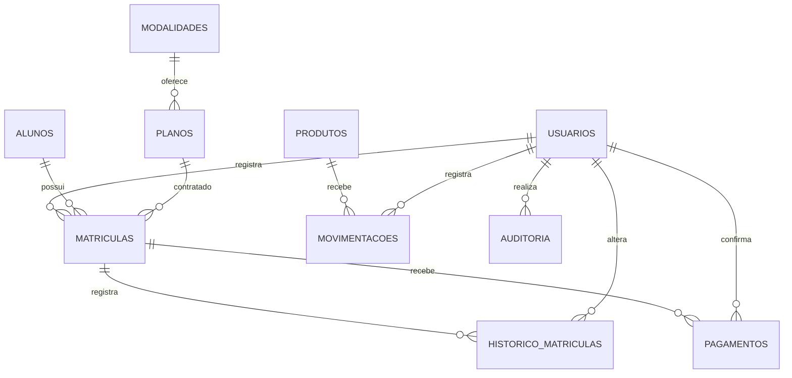

# Modelo do banco

Este modelo descreve o banco relacional H2 da versão desktop para IntelliJ, que é o sistema oficial da entrega. A demonstração pública da Vercel usa IndexedDB por navegador e não compartilha esse banco. Veja `docs/versao-web.md`.

Todas as entidades têm chave primária numérica `id`. O SQL completo está em `database/schema.sql`; `database/banco-demonstracao.sql` é a exportação de um banco novo com os dados de demonstração.

| Entidade | Dados principais | Relações |
| --- | --- | --- |
| usuarios | nome, login único, senha com hash, perfil, ativo, foto opcional, tentativas, bloqueado_ate | responsável por contratos, históricos, pagamentos, estoque e auditoria |
| alunos | nome, CPF único, telefone, e-mail, ativo, foto opcional | um aluno pode ter várias matrículas |
| modalidades | nome único, descrição, ativo | uma modalidade pode ter vários planos |
| planos | nome único, modalidade_id, valor, meses, ativo | um plano pode aparecer em várias matrículas |
| matriculas | aluno_id, plano_id, início, fim, valor, situação, criado_por | liga aluno e plano, com valor congelado da contratação |
| historico_matriculas | matricula_id, situação, motivo, usuario_id, data | várias alterações para uma matrícula |
| pagamentos | matricula_id, valor, forma, usuario_id, data | zero ou várias parcelas para cada contratação |
| produtos | nome único, unidade, preço, saldo, mínimo, ativo | um produto pode ter várias movimentações |
| movimentacoes | produto_id, tipo, quantidade, motivo, usuario_id, data, saldo_apos | entrada ou saída atribuída a um usuário, com o saldo resultante |
| auditoria | usuario_id, data, entidade, registro_id, ação, detalhes | quem alterou, quando e o que mudou em alunos, modalidades, planos, produtos e usuários |

## Valores calculados (não gravados)

- **Situação exibida**: `ATIVA` com `fim` anterior a hoje aparece como `VENCIDA`. A coluna `situacao` só aceita ATIVA, TRANCADA e CANCELADA; o vencimento é calculado na consulta (`AcademiaService.SITUACAO_ATUAL`), então não depende de rotina agendada.
- **Pagamento**: total pago é `SUM(pagamentos.valor)` da matrícula; saldo devedor é `valor - pago`; status PENDENTE (nada pago), PARCIAL ou PAGO (`AcademiaService.STATUS_PAGAMENTO`).
- **Alerta de estoque**: produto ativo com `saldo <= minimo`.

A situação e o pagamento são informações distintas. Uma matrícula ativa pode estar pendente de pagamento. Uma cancelada conserva os registros antigos para consulta. Inativar modalidade, plano ou produto apenas marca `ativo = FALSE`; nada é excluído.

## Remoção de cadastros

`AcademiaService.remover` (e os atalhos `removerAluno`, `removerModalidade`, `removerPlano`, `removerProduto`, `removerUsuario`) decide dentro de uma transação, com a linha bloqueada:

- **sem registros dependentes**: `DELETE` de verdade, com uma linha `EXCLUSAO` na auditoria guardando o que foi apagado;
- **com dependentes** (aluno com matrículas, plano com matrículas, modalidade com planos, produto com movimentações, usuário que registrou matrícula, histórico, pagamento, movimento ou auditoria): `ativo = FALSE` e linha `INATIVACAO` na auditoria; uma modalidade inativada leva junto seus planos ativos;
- **bloqueado**: aluno com matrícula ATIVA ou TRANCADA, plano ou modalidade com matrícula aberta, produto com saldo, a própria conta ou o último administrador ativo.

As chaves estrangeiras garantem que um `DELETE` com dependentes seja recusado pelo próprio banco, mesmo que a regra da aplicação falhasse. Matrículas, pagamentos, movimentações, históricos e auditoria nunca são apagados. A coluna `ativo` existe em todas as entidades removíveis (`alunos` e `usuarios` desde a primeira versão; `modalidades`, `planos` e `produtos` por `ALTER TABLE ... ADD COLUMN IF NOT EXISTS ... DEFAULT TRUE`).

O CPF continua `VARCHAR(11) UNIQUE`; a aplicação aceita qualquer sequência de 11 números (dados fictícios), sem conferir dígitos verificadores.

## Integridade e transações

O banco exige referências existentes, valores válidos e saldos não negativos. A aplicação valida CPF, permissões, duplicidade de matrícula aberta e o limite do saldo devedor. Estoque, situação, pagamento, renovação, inativação e edição de usuário usam transações: se uma instrução falhar, toda a operação volta ao estado anterior. A linha da auditoria é gravada na mesma transação da alteração.

A saída de estoque atualiza somente quando `saldo >= quantidade`, e o `saldo_apos` é lido da linha já bloqueada pela atualização. A matrícula bloqueia a linha do aluno durante a verificação de duplicidade, impedindo duas contratações iguais simultâneas. Pagamento e renovação bloqueiam a linha da matrícula, impedindo que duas parcelas simultâneas ultrapassem o valor.

## Migração de bancos anteriores

Ao abrir, `Database` executa `schema.sql`, que só cria o que falta (`CREATE TABLE IF NOT EXISTS`, `ALTER TABLE ... ADD COLUMN IF NOT EXISTS`). Para um banco da versão anterior:

1. as colunas `ativo`, `tentativas`, `bloqueado_ate` e `saldo_apos` são adicionadas com valores padrão;
2. `saldo_apos` das movimentações antigas é reconstruído pela soma acumulada de cada produto;
3. a tabela `auditoria` é criada vazia;
4. a restrição UNIQUE antiga de `pagamentos.matricula_id` é removida pelo nome lido do catálogo do H2.

Nenhum registro é apagado. Os casos CT-102 a CT-104 reproduzem esse cenário a partir de um banco com o esquema anterior.
