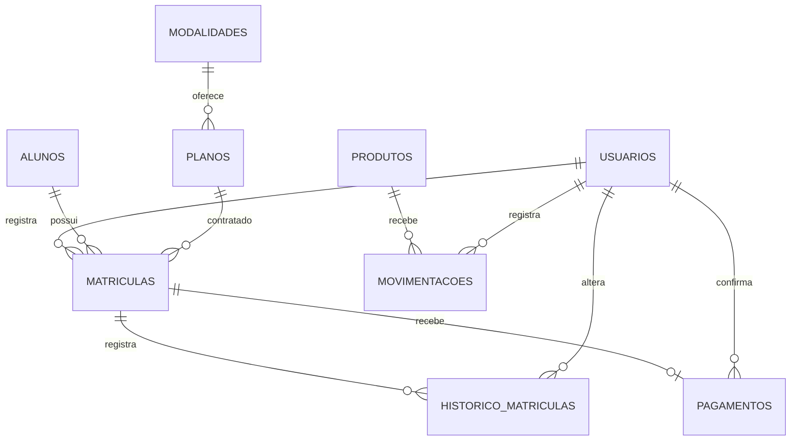

# Modelo do banco

Todas as entidades têm chave primária numérica `id`. O SQL completo está em `database/schema.sql`.

| Entidade | Dados principais | Relações |
| --- | --- | --- |
| usuarios | nome, login único, senha com hash, perfil, ativo, foto opcional | responsável por contratos, históricos, pagamentos e estoque |
| alunos | nome, CPF único, telefone, e-mail, ativo, foto opcional | um aluno pode ter várias matrículas |
| modalidades | nome único, descrição | uma modalidade pode ter vários planos |
| planos | nome único, modalidade_id, valor, meses | um plano pode aparecer em várias matrículas |
| matriculas | aluno_id, plano_id, início, fim, valor, situação, criado_por | liga aluno e plano, com valor congelado da contratação |
| historico_matriculas | matricula_id, situação, motivo, usuario_id, data | várias alterações para uma matrícula |
| pagamentos | matricula_id único, valor, forma, usuario_id, data | zero ou um pagamento para cada contratação |
| produtos | nome único, unidade, preço, saldo, mínimo | um produto pode ter várias movimentações |
| movimentacoes | produto_id, tipo, quantidade, motivo, usuario_id, data | entrada ou saída atribuída a um usuário |

A situação e o pagamento são informações distintas. Uma matrícula ativa pode estar pendente de pagamento. Uma cancelada conserva os registros antigos para consulta.

O banco exige referências existentes, valores válidos e saldos não negativos. A aplicação valida CPF, permissões e duplicidade de matrícula aberta. As operações de estoque e situação usam transações: se uma instrução falhar, toda a operação volta ao estado anterior.

A saída de estoque atualiza somente quando `saldo >= quantidade`. O registro do movimento ocorre na mesma transação. A matrícula bloqueia a linha do aluno durante a verificação de duplicidade, impedindo duas contratações iguais simultâneas.
